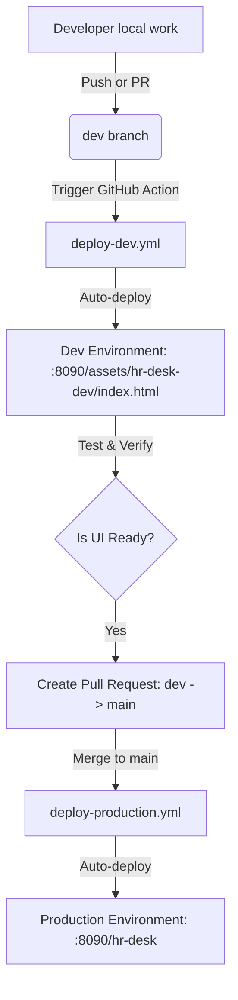

# Circle Outsourcing — HR Desk Portal & CI/CD

Welcome to the **Circle Outsourcing HR Desk Frontend & Customization Portal**. This repository powers the customized HR Desk interface for Circle Outsourcing, seamlessly integrated with Frappe HR / ERPNext.

---

## 🚀 Environments & Architecture

We maintain two fully automated deployment environments:

| Environment | Git Branch | Deployment Target | Live Access URL | Description |
| :--- | :--- | :--- | :--- | :--- |
| **Development (`dev`)** | `dev` | `/opt/erpnext-demo/hr-desk-dev/` | [Dev Preview](http://187.127.133.225:8090/assets/hr-desk-dev/index.html) | Sandbox for staging, testing UI revisions, and rapid validation. |
| **Production (`main`)** | `main` | `/opt/erpnext-demo/apps/hrms/hrms/www/` | [Production HR Desk](http://187.127.133.225:8090/hr-desk) | Live enterprise system with Frappe session authentication & CSRF protection. |

---

## 🛠️ Developer Workflow (For Arun & Team)

No direct server or SSH access is required! All code updates are deployed automatically via GitHub Actions:



### 1. Working on Features or UI Changes
1. Clone the repository:
   ```bash
   git clone https://github.com/huptle/Circel-Outsourcing.git
   cd Circel-Outsourcing
   ```
2. Checkout the `dev` branch:
   ```bash
   git checkout dev
   ```
3. Make your edits in `index.html` (or `src/` if working with the React/TypeScript source).
4. Commit and push to `dev`:
   ```bash
   git add .
   git commit -m "feat: updated HR Desk employee directory layout"
   git push origin dev
   ```
5. Check GitHub Actions tab — within ~30 seconds, your changes are live on the **Dev Preview URL**!

### 2. Promoting Changes to Production
1. Open a Pull Request from `dev` to `main` on GitHub.
2. Review the changes.
3. Once merged to `main`, GitHub Actions triggers `deploy-production.yml`.
4. The production Frappe server is updated, cache cleared, and changes go live on `http://187.127.133.225:8090/hr-desk` immediately with zero downtime.

---

## 🔐 GitHub Repository Secrets Configuration

To enable GitHub Actions deployment, configure the following secrets under **Settings > Secrets and variables > Actions > New repository secret**:

| Secret Name | Value | Purpose |
| :--- | :--- | :--- |
| `SERVER_HOST` | `187.127.133.225` | Production & Dev server IP |
| `SERVER_USER` | `root` | Deployment user |
| `SERVER_SSH_KEY` | *(RSA Private Key)* | SSH Deploy Key for secure passwordless deployment |
| `SERVER_PASSWORD` | `Huptle@001222` | Optional fallback password |
| `SERVER_PORT` | `22` | SSH Port (default: 22) |

---

## 📁 Repository Structure

```text
├── .github/
│   └── workflows/
│       ├── deploy-dev.yml          # GitHub Actions CI/CD for Development
│       └── deploy-production.yml   # GitHub Actions CI/CD for Production
├── index.html                      # Standalone, interactive HR Desk frontend
├── hr-desk.html                    # Jinja-authenticated Frappe WWW template
├── hr_desk.py                      # Python backend context & session controller
├── src/                            # TypeScript / React source modules
├── package.json                    # Project dependencies & build scripts
├── vite.config.ts                  # Vite build configuration
└── README.md                       # Documentation & Deployment guide
```

---

## 🌐 Local Testing

You can run the app locally using any static web server, or with Node/Vite:

```bash
npm install
npm run dev
```

The app will start at `http://localhost:3000`.
